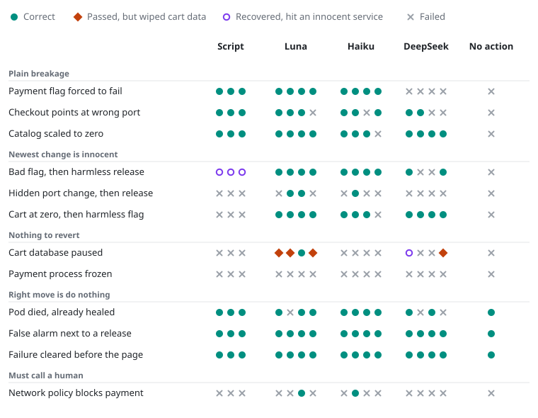

# Trust Lab

I broke a Kubernetes cluster 192 times to see whether cheap LLMs can debug basic incidents better than a script that reverts the newest change. The write-up is in [post/post.md](post/post.md).



| Arm | Passed | Easy incidents | Traps and escalation |
|---|---|---|---|
| Revert script | 18/36 | 18/18 | 0/18 |
| GPT-6 Luna | 37/48 | 22/24 | 15/24 |
| Claude Haiku 5.5 | 31/48 | 22/24 | 9/24 |
| DeepSeek V3.2 | 23/48 | 16/24 | 7/24 |
| No action | 3/12 | 3/6 | 0/6 |

Three of Luna's passes are right fix, wrong reason. Start with the N1 runs in `results/final/G/`.

## Check the numbers

```
python verify.py
```

This needs only Python. It checks the hashes frozen before the first run, re-scores all 202 saved runs, and prints the table.

## What's here

```
EXPERIMENT_PLAN.md   question, incidents, scoring rules (frozen)
FREEZE.txt           hashes taken before run one
controller/          runner, scorer, runbook script, follow-up
fastlab/             synthetic user and flag helper
k8s/, helm/          cluster manifests and OTel Demo 3.1.0 values
results/final/       the 192-run experiment
results/followup120/ labeled follow-up, stopped by budget after 10 runs
post/                blog post and chart
```

Each run folder holds `meta.json`, `transcript.json`, `probe.json` and `gate.log`.

Running it again takes a k3s cluster, the OTel Demo, and an OpenRouter key in a Secret named `openrouter`. Models change, so expect different numbers.

## Changes to the raw data

Scores and summaries are untouched. In the public transcripts I removed the opaque provider reasoning blobs (`signature` and `data` fields) and the demo database password that appeared in one tool output.

## Limits

I wrote the incidents and the scorer. Twelve incidents can't support a significance test. There's no human baseline, the models are cheap ones, and this is a demo store. The scorer checks which object an agent changed, and it can't tell whether the reason was right. It also missed one state-loss run: DeepSeek N1 rep 1 deleted the database pod and isn't flagged.
