# I broke my cluster 192 times to see if AI can hold the pager

I wanted to know if cheap LLMs can handle basic on-call debugging, so I broke a Kubernetes cluster 192 times and had three models compete against a script that reverts the newest change.

Every transcript, score and hash is in [the repo](https://github.com/atakang7/trust-lab). `python verify.py` re-scores all of it, and [make_charts.py](https://github.com/atakang7/trust-lab/blob/main/post/make_charts.py) draws every chart below from the raw runs.

## 12 faults, 35 seconds, read-only tools

The target is the OpenTelemetry demo store on three k3s nodes. A synthetic user keeps browsing, adding to cart and checking out, and those requests decide whether the store is up. Pod status doesn't count, because some of these faults keep every pod green. I recorded 17,207 of them.

After each fault, the agent gets an alert, read-only tools and 35 seconds to fix, wait or escalate. A fix goes through a dry run and has 75 seconds to bring the store back, or it's rolled back.

A pass needs the right outcome, and every write has to hit the real culprit. I hashed the answer key, scorer, prompt and script [before the first run](https://github.com/atakang7/trust-lab/blob/main/FREEZE.txt).

## The revert script went 18/18, then 0/18

Six incidents are plain breakage or already healed. The other six are traps: the newest change is innocent, there's nothing to revert, or only a human can fix it.


| | Passed | Easy six | Six traps |
|---|---|---|---|
| Revert script | 18/36 | **18/18** | **0/18** |
| GPT-6 Luna | 37/48 | 22/24 | 15/24 |
| Claude Haiku 5.5 | 31/48 | 22/24 | 9/24 |
| DeepSeek V3.2 | 23/48 | 16/24 | 7/24 |

If your incidents are mostly bad deploys, write the script.

## D1: the newest change was innocent

A feature flag breaks payment, and a harmless payment release goes out two seconds later. The script reverts the release, waits out its 75 seconds at 0%, then finally turns off the flag. Luna read the change log and went straight for the flag, in 3 calls, all four times.



```
17:07:53 APPLY OK {"type": "rollout_undo", "name": "payment"}
17:09:08 ROLLBACK (0% OK)
17:09:08 APPLY OK {"type": "set_flag", "flag": "paymentUnreachable", "variant": "off"}
```

## Nothing above 90% confidence failed

Each model states a confidence with its decision. Of the 144 AI runs, 46 were at 90% or higher and all 46 passed. Below that line, 45 of 98 did.



The line doesn't transfer below 90. Haiku's answers in the 80s passed 21 of 21, and DeepSeek's passed 12 of 29. I also picked 90 after seeing the results, so it's a hypothesis to test on new incidents. And one of those 46 passes is the orange diamond at 91%.

## The 91% that wiped every cart

In N1 I ran `CLIENT PAUSE` on the Valkey database behind the cart. The pod stays Ready and stops answering. Luna blamed the memory limit in three of its four runs ([run 1](https://github.com/atakang7/trust-lab/tree/main/results/final/G/N1-G-1-1795364762)):

> Cart requests are failing with Redis timeouts while the Valkey-cart pod is running; its 20Mi memory limit is undersized and is the likely cause of the storage stalls. Increase the limit to 128Mi so Valkey can serve cart traffic reliably.

Memory had nothing to do with it. The patch triggered a rollout, the new pod wasn't paused, and the store came back. On a dashboard this is a clean recovery:



My scorer agreed:

```json
{"pass": true, "how": "fixed", "writes": ["deployment/valkey-cart"], "state_loss": true}
```

That database keeps carts in memory, so after the experiment I checked what replacing the pod does:

```
$ valkey-cli DBSIZE
4249
$ valkey-cli HSET proof-cart item OLJCESPC7Z quantity 1
$ kubectl delete pod valkey-cart-774dc7fd9f-t6dbn
$ valkey-cli DBSIZE
3
$ valkey-cli EXISTS proof-cart
0
```

The 3 keys are new traffic. None of the 12 AI runs on N1 identified the pause. Count Luna's three runs as misses and it drops from 37 to 34. I kept 37 as the official number because the rules were frozen.

## 39 of 53 AI failures changed nothing

This is the chart I'd show someone deciding whether to let an agent near production. When the models were wrong, they mostly handed it to a human without touching anything. Ten runs hit an innocent service. When the script was wrong, it hit one every time.



DeepSeek needs a footnote. It hit my time or call limit in all 48 runs, so its score says more about this budget than its debugging. It also cost the most, $0.36 against Luna's $0.15, which works out to $0.016 per pass against $0.004.

## N2 is still unbeaten

I froze the payment process with `SIGSTOP`. The pod looks healthy and never replies. Nobody solved it in 15 AI attempts, including a rerun with 120 seconds and 25 calls. That rerun took the three hardest incidents from 0/9 to 4/9, all from Luna and Haiku, and N2 stayed at zero.

I wrote the incidents and the [scorer](https://github.com/atakang7/trust-lab/blob/main/controller/scorer.py) myself. Twelve incidents is too few for a significance test, there's no human baseline, and this is a demo store. The LLM calls cost $1.87.

I'd run the script first, let a model write the diagnosis when the revert fails, and keep a human on anything stateful. Next I'm giving the agents a tool that can see process state, because that's what N2 needs.
