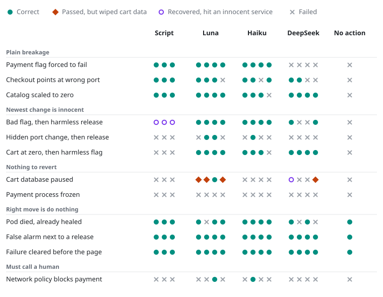

# I broke my cluster 192 times to see if AI can hold the pager

I wanted to know if cheap LLMs can handle basic on-call debugging, so I broke a Kubernetes cluster 192 times and had three models compete against a script that reverts the newest change.

Every transcript, score and hash is in [the repo](https://github.com/atakang7/trust-lab). `python verify.py` re-scores all of it.

## The setup

The target is the OpenTelemetry demo store on three k3s nodes. A synthetic user keeps browsing, adding to cart and checking out, and that decides whether the store is up. Pod status doesn't count, because some of these faults keep every pod green.

There are 12 incidents. Six are plain breakage or already healed. The other six are traps: the newest change is innocent, there's nothing to revert, or only a human can fix it.

A pass needs the right outcome, and every write has to hit the real culprit. I hashed the answer key, scorer, prompt and script [before the first run](https://github.com/atakang7/trust-lab/blob/main/FREEZE.txt).

## Results



| | Passed | Easy | Traps |
|---|---|---|---|
| Revert script | 18/36 | **18/18** | **0/18** |
| GPT-6 Luna | 37/48 | 22/24 | 15/24 |
| Claude Haiku 5.5 | 31/48 | 22/24 | 9/24 |
| DeepSeek V3.2 | 23/48 | 16/24 | 7/24 |

If your incidents are mostly bad deploys, write the script. The models only earn their place on the traps.

## Where the script lost

In D1, a feature flag breaks payment and a harmless payment release goes out two seconds later. The script reverts the release, because it's the newest change:

```
17:07:53 APPLY OK {"type": "rollout_undo", "name": "payment"}
17:09:08 ROLLBACK (0% OK)
17:09:08 APPLY OK {"type": "set_flag", "flag": "paymentUnreachable", "variant": "off"}
```

Luna read the change log and turned off the flag in 3 calls, in all four runs.

## Where the AI fooled my scorer

In N1 I ran `CLIENT PAUSE` on the Valkey database behind the cart. The pod stays Ready and stops answering. In three of its four runs, Luna blamed the memory limit, at 91, 76 and 84% confidence ([run 1](https://github.com/atakang7/trust-lab/tree/main/results/final/G/N1-G-1-1795364762)):

> Cart requests are failing with Redis timeouts while the Valkey-cart pod is running; its 20Mi memory limit is undersized and is the likely cause of the storage stalls. Increase the limit to 128Mi so Valkey can serve cart traffic reliably.

Memory had nothing to do with it. The patch triggered a rollout, the new pod wasn't paused, and the store came back. My scorer saw the right object and a healthy store:

```json
{"pass": true, "how": "fixed", "writes": ["deployment/valkey-cart"], "state_loss": true}
```

That database keeps carts in memory, so I checked what replacing the pod does:

```
$ valkey-cli DBSIZE
4249
$ valkey-cli HSET proof-cart item OLJCESPC7Z quantity 1
$ kubectl delete pod valkey-cart-774dc7fd9f-t6dbn
$ valkey-cli DBSIZE
3
$ valkey-cli EXISTS proof-cart
0
```

Every cart was gone, and the 3 keys are new traffic. None of the 12 AI transcripts for N1 mention the pause. Count those three runs as misses and Luna drops from 37 to 34. I kept 37 as the official number because the rules were frozen.

## Limits

DeepSeek hit my time or call limit in all 48 runs, so its score says more about this budget than its debugging. With 120 seconds and 25 calls on the three hardest incidents, passes went from 0/9 to 4/9, all from Luna and Haiku.

Nobody solved N2, a payment process frozen with `SIGSTOP`, in 15 AI attempts.

I wrote the incidents and the [scorer](https://github.com/atakang7/trust-lab/blob/main/controller/scorer.py) myself. Twelve incidents is too few for a significance test, there's no human baseline, and this is a demo store. The LLM calls cost $1.87.

I'd run the script first, let a model write the diagnosis when the revert fails, and keep a human on anything stateful. Next I want to give the agents a tool that can see process state, because N2 is still unbeaten.
